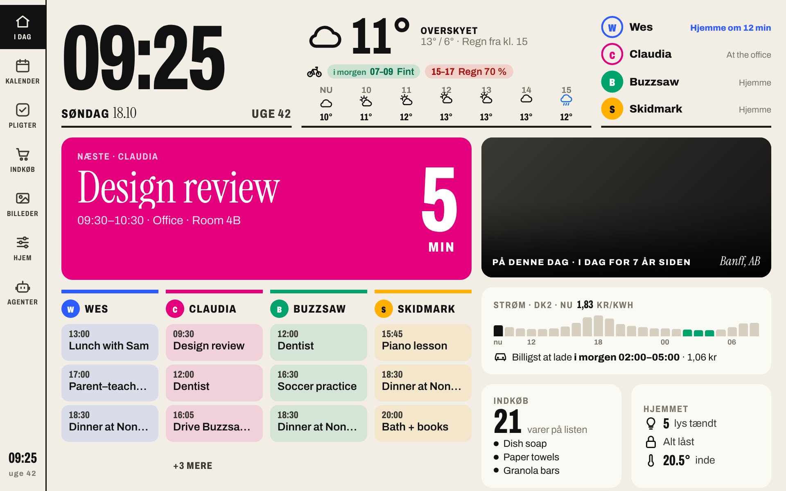

# Family wall dashboard

Our kitchen wall dashboard for the family in Birkerød. It runs full screen on a 10–11" Android
tablet (landscape, ~1920×1200) in Fully Kiosk Browser. The tablet only opens a URL; all logic
lives in this web app, which will be hosted on Railway.

Started as a fork of [wesbos/photo-frame-dashboard](https://github.com/wesbos/photo-frame-dashboard).
Project brief, requirements and phase plan: [CLAUDE.md](CLAUDE.md). Decisions: [ROD.md](ROD.md).
History: [CHANGELOG.md](CHANGELOG.md).



## Status

Work in progress (phase 4). Live today: Danish clock/date/week number, weather for Birkerød
with a bike-commute hint (Open-Meteo), and DK2 electricity prices with the cheapest charging
window (Energi Data Service). Calendar-based widgets still use mock data from
`dashboard/js/data.js` until the iCal addresses are added.

## Run locally

Requires Node.js 22+.

```sh
cd dashboard
npm install
npm run dev        # → http://localhost:5173/?token=dev
npm test           # server tests
```

`npm run dev` runs Vite with the backend built in. Without a `.env` the token is `dev`.
Offline? `MOCK=1 npm run dev` serves mock weather and prices instead of calling the APIs.

Demo controls: press and hold the clock in the left rail, or press **D**. Keys **A** (ambient),
**N** (night) and **1–7** (views) also work.

To run exactly what production runs:

```sh
cp .env.example .env      # then set DASHBOARD_TOKEN (openssl rand -hex 24)
npm run build
npm start                 # → http://localhost:3000/?token=<your token>
```

## Access token

Every request except `/healthz` needs the secret token. The tablet opens
`https://<host>/?token=<DASHBOARD_TOKEN>`; the server checks it and stores it in an HttpOnly
cookie, so scripts, styles and API calls work without repeating it. Wrong or missing token →
`401 Ingen adgang`. Keep the token out of the repo and screenshots; to revoke it, change
`DASHBOARD_TOKEN` and update the tablet's start URL.

## API

All endpoints are `GET`, need the token, and return the same envelope:

```json
{ "widget": "weather", "data": { … }, "source": "mock", "updatedAt": "2026-10-18T06:53:16Z", "stale": false }
```

If a source fails, the last good `data` is returned with `"stale": true` and an `error` message.
If there has never been good data, `data` is `null` and the status is 503.

| Endpoint | Widget | Source | Refresh |
| --- | --- | --- | --- |
| `/api` | list of widgets | – | – |
| `/api/clock` | date, Danish weekday, ISO week number, server time | server clock | every request |
| `/api/kids` | icon plan for the kids today | mock (calendar later) | 5 min |
| `/api/dropoff` | who does Pilegården drop-off / pick-up | mock (calendar later) | 5 min |
| `/api/calendar` | people + today and the next 3 days | mock (iCal later) | 5 min |
| `/api/weather` | Birkerød now, today, 48 h hourly, bike-commute verdicts | **Open-Meteo** | 15 min |
| `/api/electricity` | DK2 hourly spot prices today/tomorrow, cheapest charging window | **Energi Data Service** | 30 min |
| `/api/birthdays` | birthdays and family events this month | mock (calendar later) | 60 min |
| `/api/photos` | slideshow photos | mock | 60 min |
| `/healthz` | health check for Railway (no token) | – | – |

The browser polls weather every 10 min and prices every 15 min, and keeps the last good copy in
`localStorage`. If the server or Wi-Fi is down it shows that copy with a small "data fra 14:05" marker.

**Bike commute** (07–09 and 15–17; after a window ends it shows tomorrow's): *Fint* (green),
*Ok* (amber: rain chance ≥ 30 %, wind ≥ 7 m/s or gusts ≥ 12, ≤ 2 °C) or *Dårligt* (red: rain
≥ 1 mm or likely rain, wind ≥ 11 m/s or gusts ≥ 17, ≤ −3 °C, snow). Thresholds live in
`server/sources/weather.js`.

**Electricity** is the raw day-ahead spot price in DKK/kWh, *without* VAT, taxes or grid
tariffs. Tomorrow's prices are published around 13:00. The cheapest window is the cheapest run of
`CHARGE_HOURS` consecutive hours from now on.

## Project layout

```
dashboard/
  index.html          single page: left rail, views, overlay layers
  js/main.js          loads the modules below in order
  js/data.js          remaining frontend mock data (people, events, photos, chores, ...)
  js/app.js           router, time/format helpers, idle → ambient → night modes, scaling
  js/views/*.js       one file per view (home, calendar, photos, ambient, ...)
  css/tokens.css      colours, font sizes, spacing
  css/views/*.css     one stylesheet per view
  vite.config.js      build config; also mounts the backend into `npm run dev`
  server/index.js     production entry (`npm start`)
  server/app.js       request handler: health → token → /api → static files
  server/auth.js      token check + cookie
  server/cache.js     last-known-good cache, "stale" marking
  server/widgets.js   widget registry (name, refresh interval, data source)
  server/mock.js      mock data per widget, in the shapes the real sources will use
  server/family.js    people and colours
  server/time.js      Europe/Copenhagen date helpers, ISO week number
  server/sources/     real data sources: weather.js (Open-Meteo), electricity.js (Energi Data Service)
  js/api.js           polls /api, keeps last good data in localStorage, "stale" marker
  test/               `npm test` (node:test, no extra dependencies)
screenshots/          a screenshot per phase, for comparing versions
```

## Environment variables

Template: [`dashboard/.env.example`](dashboard/.env.example). Never commit `.env`.

| Variable | Required | Purpose |
| --- | --- | --- |
| `DASHBOARD_TOKEN` | yes (production) | secret in the tablet's URL. `openssl rand -hex 24` |
| `KID1_NAME`, `KID2_NAME` | no | kids' names, kept out of the public repo |
| `CHARGE_HOURS` | no | length of the cheapest charging window, default 3 |
| `MOCK` | no | `1` = mock data for every widget (offline development) |
| `PORT` | no | set by Railway; defaults to 3000 |

Calendar iCal addresses are added here when the calendar widgets go live.
